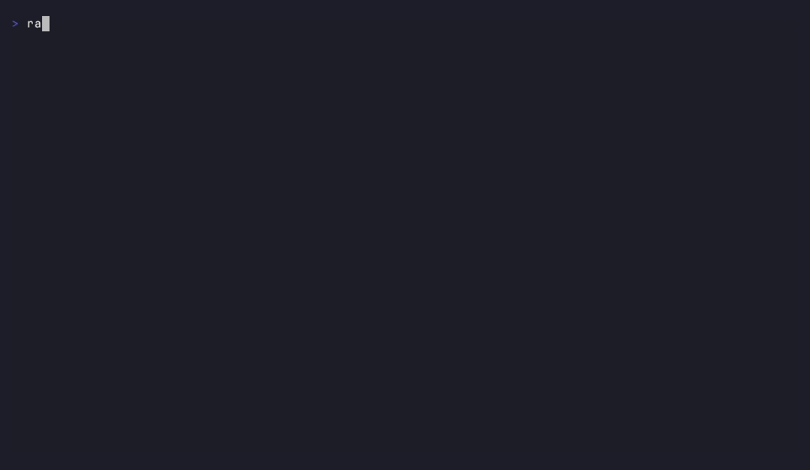
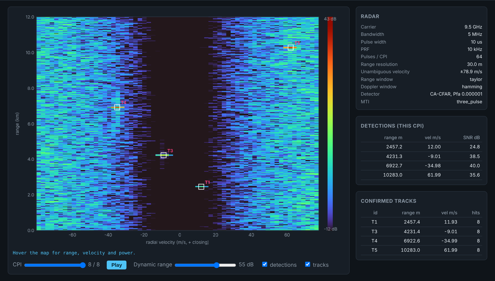

# radar-signal-processing-sim

**A dependency-free C++17 pulse-Doppler radar simulator: from the radar range equation to confirmed tracks, with every stage tested against theory.**

[](https://github.com/bekirhankarakurt/radar-signal-processing-sim/actions/workflows/ci.yml)
[](https://github.com/bekirhankarakurt/radar-signal-processing-sim/actions/workflows/codeql.yml)
[](https://bekirhankarakurt.github.io/radar-signal-processing-sim/coverage/)
[](https://github.com/bekirhankarakurt/radar-signal-processing-sim/releases/latest)
[](LICENSE)


**[Documentation](https://bekirhankarakurt.github.io/radar-signal-processing-sim/)**: API reference, coverage report and live range-Doppler viewers.



## Why / what

- **End-to-end chain.** Simulates the raw I/Q data cube, then runs LFM pulse compression, the corner turn, the MTI canceller, the Doppler FFT, 2-D CA-/OS-CFAR, clustering and a track-before-display tracker.
- **Physics, not just pictures.** Target amplitudes come from the radar range equation and thermal noise from kT₀BF. Swerling 0/1 fluctuation and Gaussian-spectrum ground clutter are included.
- **Verified against theory.** The tests check range resolution, matched-filter gain, sidelobe levels, the Doppler bin, CFAR Pfa and Pd against closed-form results. The Monte Carlo mode measures Pd vs SNR through the whole chain.
- **Built for speed.** Uses its own radix-2 FFT, contiguous row-major data cubes, a tiled corner turn, an O(1)-per-cell CA-CFAR on a summed-area table and optional OpenMP. Results stay identical whatever the thread count, and every stage reports its own timing.
- **Zero dependencies.** Needs only a C++17 compiler and CMake. Outputs are PPM, CSV and a self-contained HTML viewer.

## Demo

`radar_sim run scenarios/default.ini` processes 8 CPIs of an X-band surveillance radar. The scene holds a small UAV, a ground vehicle inside the clutter, a helicopter and a fast aircraft:

```text
Scenario 'x-band-surveillance': 4 target(s), 8 CPI(s), 64 pulses x 902 samples, 4 thread(s)
CPI 0: 5 detections
    range    2500.0 m   velocity   11.91 m/s   SNR  22.0 dB   cells 8
    range    3042.9 m   velocity  -44.38 m/s   SNR  11.8 dB   cells 1
    range    4199.9 m   velocity   -9.01 m/s   SNR  39.0 dB   cells 15
    range    6799.8 m   velocity  -34.97 m/s   SNR  35.4 dB   cells 13
    range   10500.2 m   velocity   61.98 m/s   SNR  33.3 dB   cells 12
...
Confirmed tracks: 4
  id        range m     vel m/s    SNR dB   hits       CPIs
  1          2457.4       11.93      24.8      8        0-7
  3          4231.4       -9.01      38.5      8        0-7
  4          6922.6      -34.99      40.0      8        0-7
  5         10283.0       61.99      35.6      8        0-7
```

The single-cell hit at 3042.9 m is a genuine false alarm (Pfa = 10⁻⁶). It opens track 2, which never reaches 3-of-4 confirmation and is dropped, so only the four real targets are displayed.



*Last CPI in `viewer.html`. The dark band around 0 m/s is the three-pulse MTI notch, which suppresses clutter and noise alike. White boxes are clustered CFAR detections and the labels are confirmed tracks. Live versions: [default](https://bekirhankarakurt.github.io/radar-signal-processing-sim/viewer/default.html), [formation (OS-CFAR)](https://bekirhankarakurt.github.io/radar-signal-processing-sim/viewer/formation_os_cfar.html), [S-band benchmark](https://bekirhankarakurt.github.io/radar-signal-processing-sim/viewer/benchmark.html).*

## 60-second quick start

```bash
git clone https://github.com/bekirhankarakurt/radar-signal-processing-sim.git
```

```bash
cd radar-signal-processing-sim && cmake -S . -B build -DCMAKE_BUILD_TYPE=Release && cmake --build build -j
```

```bash
./build/radar_sim run scenarios/default.ini -o out
```

Open `out/viewer.html` in a browser. To skip the build, download a static binary from [Releases](https://github.com/bekirhankarakurt/radar-signal-processing-sim/releases/latest):

```bash
curl -sL https://github.com/bekirhankarakurt/radar-signal-processing-sim/releases/download/v1.0.0/radar_sim-v1.0.0-linux-x86_64.tar.gz | tar xz
```

```bash
cd radar_sim-v1.0.0-linux-x86_64 && ./bin/radar_sim run scenarios/default.ini -o out
```

## Requirements and build options

| Requirement | Version | Notes |
|---|---|---|
| C++ compiler | GCC or Clang with C++17 support | CI uses GCC 13 and Clang 18 |
| CMake | ≥ 3.16 | |
| OpenMP | optional | `libgomp` (GCC) or `libomp-dev` (Clang). Falls back to single-threaded |
| doxygen, gcovr, cppcheck, clang-tidy | optional | API docs, coverage and static analysis only |

| CMake option | Default | Effect |
|---|---|---|
| `CMAKE_BUILD_TYPE` | `Release` | `Release` builds with `-O3` |
| `RADAR_ENABLE_OPENMP` | `ON` | Parallelises signal generation, compression, the corner turn, MTI, Doppler, CFAR and Monte Carlo trials |
| `RADAR_BUILD_TESTS` | `ON` | Builds the CTest suite |
| `RADAR_ENABLE_SANITIZERS` | `OFF` | AddressSanitizer + UndefinedBehaviorSanitizer |
| `RADAR_ENABLE_COVERAGE` | `OFF` | gcov instrumentation (`--coverage -O0`) |
| `RADAR_WARNINGS_AS_ERRORS` | `OFF` | `-Werror` on top of `-Wall -Wextra -Wpedantic -Wshadow -Wconversion -Wsign-conversion` |
| `RADAR_NATIVE` | `OFF` | `-march=native` |
| `RADAR_STATIC` | `OFF` | Fully static `radar_sim`, as used for the release archives |

## Usage

```text
radar_sim run <scenario.ini> [options]         simulate and process CPIs, write map/detections/tracks
radar_sim montecarlo <scenario.ini> [options]  Pd vs SNR and empirical Pfa through the full chain
radar_sim info <scenario.ini>                  print derived radar parameters and link budget
radar_sim --help | --version

-o, --output <dir>   output directory (default: out)
--cpis <n> / --seed <n> / --trials <n>         override scenario values
--cfar <ca|os>  --mti <none|two_pulse|three_pulse>  --swerling <0|1>
--threads <n>        OpenMP thread count (default: all cores)
--dynamic-range <dB> PPM image dynamic range (default: 60)
-q, --quiet          only print the summary and timing
```

**`run` outputs:** `range_doppler.ppm` (last CPI with detection boxes), `range_doppler.csv` (dB, range × velocity), `detections.csv`, `tracks.csv`, `timing.csv` and `viewer.html` (all CPIs, with a slider, hover read-out and tracks). **`montecarlo` outputs:** `pd_curve.csv` and `timing.csv`.

### Scenario file reference

The format is INI. `;` and `#` start comments. Repeat `[target]` once per target. Unknown keys are errors, which catches typos.

| Section | Key | Default | Meaning |
|---|---|---|---|
| `[simulation]` | `name`, `seed` | `scenario`, `1` | Label and RNG seed (results are reproducible) |
| | `cpis` | `1` | Number of coherent processing intervals |
| | `cpi_interval_s` | `0` | Revisit time between CPI starts. `0` means back-to-back CPIs |
| | `noise` | `true` | Add thermal noise |
| `[radar]` | `carrier_hz`, `bandwidth_hz` | `9.5e9`, `5e6` | Carrier and LFM sweep |
| | `pulse_width_s`, `prf_hz`, `pulses` | `10e-6`, `10e3`, `64` | Waveform and CPI length |
| | `sample_rate_hz` | `10e6` | Complex sampling rate (≥ bandwidth) |
| | `peak_power_w`, `antenna_gain_db` | `2e3`, `32` | Radar equation terms |
| | `noise_figure_db`, `system_loss_db` | `3`, `4` | Radar equation terms |
| | `max_range_m` | `12000` | Processed range window (must fit in c/2PRF) |
| `[processing]` | `range_window`, `doppler_window` | `taylor`, `hamming` | `none`, `hann`, `hamming` or `taylor` (+ `_taylor_nbar`, `_taylor_sll_db`) |
| | `mti` | `none` | `none`, `two_pulse` or `three_pulse` |
| | `cfar`, `cfar_pfa` | `ca`, `1e-6` | Detector and design false-alarm probability |
| | `guard_range`, `guard_doppler` | `2`, `1` | Guard cells (half-width) |
| | `train_range`, `train_doppler` | `8`, `4` | Training cells (half-width) |
| | `os_rank` | `0.75` | OS-CFAR order statistic k/N |
| | `doppler_fft` | auto | Doppler FFT length (power of two, ≥ pulses) |
| | `clutter_notch_mps` | `0` | Discard hits with \|v\| below this |
| `[clutter]` | `enabled`, `cnr_db` | `false`, `30` | Ground clutter and its clutter-to-noise ratio per raw sample |
| | `min_range_m`, `max_range_m` | `0`, `5000` | Clutter extent |
| | `spectral_width_mps` | `0.25` | σ of the Gaussian clutter velocity spectrum |
| `[tracker]` | `confirm_hits`, `confirm_window` | `3`, `4` | M-of-N confirmation |
| | `max_misses` | `3` | Consecutive misses before a confirmed track is deleted |
| | `range_gate_m`, `velocity_gate_mps` | `60`, `4` | Association gates |
| | `alpha`, `beta` | `0.6`, `0.2` | Range and velocity smoothing gains |
| `[monte_carlo]` | `snr_min_db`, `snr_max_db`, `snr_step_db` | `0`, `20`, `1` | SNR sweep (SNR in the range-Doppler cell) |
| | `trials`, `pfa_trials` | `200`, `20` | Trials per SNR and noise-only maps for Pfa |
| | `swerling` | `1` | `0` or `1` |
| | `range_m`, `velocity_mps` | mid-window, v_max/2 | Test target (snapped to bin centres) |
| `[target]` | `range_m`, `velocity_mps`, `rcs_m2`, `swerling` | `0`, `0`, `1`, `0` | Velocity is positive when closing |

Shipped scenarios: `default.ini` (X-band, clutter + MTI), `formation_os_cfar.ini` (CA vs OS masking), `monte_carlo.ini` (detection study) and `benchmark.ini` (S-band, 60 km, 128 pulses).

### Recipes

**1. CA-CFAR masking vs OS-CFAR.** In this scenario a 4 m² lead aircraft flies 105 m ahead of a 0.5 m² wingman:

```bash
./build/radar_sim run scenarios/formation_os_cfar.ini -q --cfar ca -o out/ca
```

```bash
./build/radar_sim run scenarios/formation_os_cfar.ini -q --cfar os -o out/os
```

CA-CFAR confirms 1 track, because the lead sits in the wingman's reference window and raises its threshold. OS-CFAR confirms both.

**2. What MTI buys you.** Without the canceller, the clutter ridge at 0 m/s produces about 37 detections per CPI. That gives 30 confirmed tracks, 27 of them on clutter, and the UAV inside the clutter is lost:

```bash
./build/radar_sim run scenarios/default.ini -q --mti none -o out/nomti
```

**3. Detection curve for a steady target with OS-CFAR:**

```bash
./build/radar_sim montecarlo scenarios/monte_carlo.ini --swerling 0 --cfar os -o out/mc
```

**4. Scaling check.** Compare the per-stage timing with 1 thread and with all cores:

```bash
./build/radar_sim run scenarios/benchmark.ini -q --threads 1 -o out/bench
```

**5. Another noise realisation.** Change the seed. Results stay bit-identical for a given seed, whatever the thread count:

```bash
./build/radar_sim run scenarios/default.ini -q --seed 7 -o out/seed7
```

## Signal-processing chain

```text
 scenario.ini
     |
     v
 +-------------------+   targets: radar equation, Swerling 0/1, stop-and-hop motion
 | Signal model      |   thermal noise: CN(0, 1) per sample (all powers are SNRs)
 | pulses x samples  |   clutter: reflectivity (Cholesky-coloured, Gaussian spectrum) * chirp
 +-------------------+
     |  rows = pulses (fast time contiguous)
     v
 +-------------------+   X(f) . conj(S_w(f)), unit-energy windowed reference
 | Pulse compression |   radix-2 FFT, Hamming / Taylor taper
 +-------------------+
     |
     v
 +-------------------+   tiled 32x32 transpose -> rows = range bins (slow time contiguous)
 | Corner turn       |
 +-------------------+
     |
     v
 +-------------------+   [1 -1]/sqrt2 or [1 -2 1]/sqrt6 (unit noise gain)
 | MTI canceller     |
 +-------------------+
     |
     v
 +-------------------+   windowed slow-time FFT, fftshift, |.|^2 -> range-Doppler power map
 | Doppler FFT       |
 +-------------------+
     |
     v
 +-------------------+   CA: summed-area table, O(1)/cell   OS: k-th order statistic
 | 2-D CFAR          |   Doppler axis circular, optional zero-velocity notch
 +-------------------+
     |
     v
 +-------------------+   8-connected components, power-weighted centroid
 | Clustering        |
 +-------------------+
     |
     v
 +-------------------+   gated global nearest neighbour, alpha/beta smoothing,
 | Tracker           |   M-of-N confirmation -> only confirmed tracks are displayed
 +-------------------+
     |
     v
  PPM / CSV / viewer.html / timing report
```

**Radar range equation** (received power and per-sample SNR, noise bandwidth = sampling rate $f_s$):

$$P_r = \frac{P_t G^2 \lambda^2 \sigma}{(4\pi)^3 R^4 L}, \qquad \mathrm{SNR} = \frac{P_r}{k T_0 F f_s}$$

**Resolution and ambiguities** ($N_p$ pulses per CPI):

$$\Delta R = \frac{c}{2B}, \qquad \Delta v = \frac{\lambda\,\mathrm{PRF}}{2 N_p}, \qquad R_{ua} = \frac{c}{2\,\mathrm{PRF}}, \qquad v_{ua} = \pm\frac{\lambda\,\mathrm{PRF}}{4}$$

**Coherent gain** of a taper $w$ (pulse compression and Doppler alike). For the rectangular window it equals $N$ (the time-bandwidth product times oversampling, for compression):

$$G = \frac{\left(\sum_n w_n\right)^2}{\sum_n w_n^2}$$

**CFAR threshold** with $N$ training cells, square-law detected exponential noise and the cell under test $x_0$:

$$\text{CA:}\quad x_0 > \alpha\,\frac{1}{N}\sum_{i=1}^{N} x_i, \qquad \alpha = N\left(P_{fa}^{-1/N} - 1\right)$$

$$\text{OS:}\quad x_0 > \alpha\, x_{(k)}, \qquad P_{fa} = \prod_{i=0}^{k-1} \frac{N-i}{N-i+\alpha}$$

**Swerling 1 detection** (used as the reference in the Pd table):

$$P_d^{\text{ideal}} = P_{fa}^{1/(1+\mathrm{SNR})}, \qquad P_d^{\text{CA}} = \left(1 + \frac{\alpha}{N(1+\mathrm{SNR})}\right)^{-N}$$

For Swerling 0 the reference is $P_d = Q_1\!\left(\sqrt{2\,\mathrm{SNR}}, \sqrt{-2\ln P_{fa}}\right)$, computed with the project's own Marcum-Q routine.

## Design trade-offs

| Decision | Why | Cost |
|---|---|---|
| Own radix-2 FFT, `double` precision | No dependencies; plan precomputes the bit-reversal table and per-stage twiddles | About 140 µs per 8192-point transform: roughly 5x slower than FFTW, and lengths are zero-padded to powers of two |
| Noise normalised to unit power at every stage | Every number in the chain is an SNR, and the tests can check gains exactly | Absolute power (W) is only visible in `info` |
| Stop-and-hop target model | Exact per-pulse phase gives correct Doppler. Intra-pulse Doppler is negligible here (fd·T ≪ 1) | No range-Doppler coupling of the LFM for very fast targets |
| Exact Gaussian clutter spectrum (Cholesky colouring) | An AR(1) model has a Lorentzian spectrum whose tails leak clutter into every Doppler bin | O(N_p²) per clutter cell, done once per CPI |
| CA-CFAR on a summed-area table | O(1) per cell whatever the window size | Precision depends on the double-precision running sums (fine for this dynamic range) |
| OS-CFAR with `nth_element` | Robust against interfering targets and clutter edges | O(N) per cell: 1.2 s per CPI on the benchmark map (N = 652) vs 7 ms for CA |
| Tapered windows | −35 to −43 dB sidelobes keep strong targets from masking weak ones | Wider main lobes and 1–1.5 dB SNR loss. They also correlate the reference cells, so measured Pfa is about 2x the design value (it matches when both windows are rectangular) |
| Deterministic per-pulse RNG streams (xoshiro256**) | Bit-identical results for any OpenMP thread count | One seed derivation per pulse, clutter cell and trial |
| Track-before-display (M-of-N) | Isolated false alarms never reach the display | Tracks are confirmed 2–3 CPIs after first detection |

## Results: Pd and Pfa

From `radar_sim montecarlo scenarios/monte_carlo.ini`, 2000 trials per point. Each trial runs the full chain (simulation → compression → Doppler → CFAR) with N = 174 reference cells and design Pfa = 10⁻⁴. SNR is measured in the range-Doppler cell; the coherent processing gain into that cell is 28.7 dB.

| SNR (dB) | Swerling 1, CA-CFAR: simulated | Swerling 1, CA-CFAR: closed form | Swerling 1, OS-CFAR: simulated | Swerling 1, OS-CFAR: closed form | Swerling 0, CA-CFAR: simulated | Swerling 0, ideal (Marcum Q) |
|---:|---:|---:|---:|---:|---:|---:|
| 0 | 0.013 | 0.009 | 0.012 | 0.009 | 0.004 | 0.004 |
| 4 | 0.078 | 0.069 | 0.073 | 0.067 | 0.035 | 0.029 |
| 8 | 0.298 | 0.275 | 0.293 | 0.271 | 0.269 | 0.271 |
| 12 | 0.562 | 0.571 | 0.555 | 0.567 | 0.907 | 0.925 |
| 16 | 0.787 | 0.793 | 0.784 | 0.791 | 1.000 | 1.000 |
| 20 | 0.909 | 0.911 | 0.908 | 0.909 | 1.000 | 1.000 |
| 24 | 0.965 | 0.963 | 0.965 | 0.963 | 1.000 | 1.000 |

| Detector | Design Pfa | Empirical Pfa | Cells tested |
|---|---:|---:|---:|
| CA-CFAR (Taylor + Hamming windows) | 1.0 × 10⁻⁴ | 2.17 × 10⁻⁴ | 793 600 |
| OS-CFAR, k/N = 0.75 (Taylor + Hamming) | 1.0 × 10⁻⁴ | 2.21 × 10⁻⁴ | 793 600 |
| CA-CFAR (rectangular windows) | 1.0 × 10⁻⁴ | 1.12 × 10⁻⁴ | 793 600 |

The simulated Pd follows the closed form within Monte Carlo error. The empirical Pfa is about 2x the design value only when tapers correlate the reference cells, as discussed in the trade-offs above.

## Performance

`scenarios/benchmark.ini`: S-band, 128 pulses × 5285 samples (676 k complex samples) per CPI, three-pulse MTI, 10 CPIs. Measured on a 4-vCPU Intel Xeon @ 2.1 GHz with GCC 13.3, `-O3`. Times are milliseconds per CPI from the built-in timing report.

| Stage | 1 thread | 4 threads | Speed-up |
|---|---:|---:|---:|
| Signal generation (targets + noise + clutter) | 58.7 | 19.0 | 3.1x |
| Pulse compression (8192-pt FFT pairs) | 33.7 | 12.7 | 2.7x |
| Corner turn | 9.6 | 5.8 | 1.7x |
| MTI canceller | 7.5 | 5.0 | 1.5x |
| Doppler FFT | 6.2 | 2.2 | 2.9x |
| CA-CFAR | 9.7 | 7.2 | 1.3x |
| Clustering + tracking | 0.6 | 0.5 | 1.1x |
| **Receive chain total** | **67.3** | **33.4** | **2.0x** |
| Receive-chain throughput | 10.1 Msamples/s | 20.3 Msamples/s | |

The memory-bound stages (corner turn, MTI, CFAR) scale less well than the FFT stages. The 64 ms CPI is processed about 2x faster than real time on 4 cores. The OS-CFAR alternative costs 1196 ms per CPI on 4 threads for this map.

## Testing

```bash
ctest --test-dir build --output-on-failure
```

There are 12 dependency-free test executables with 66 cases in total and about 95% line coverage. Each checks an analytic expectation instead of a stored output:

| Area | Checks |
|---|---|
| FFT | Matches the O(N²) DFT, inverse round trip, Parseval, single-tone bin |
| Windows | Hamming −42.7 dB and rectangular −13.26 dB PSL, Taylor PSL within design, Hamming loss 1.34 dB |
| Pulse compression | Peak at the true delay, gain = N samples, −3 dB width = 0.886·c/2B (±5%), PSLR −13.3 dB, unit noise power, two targets 2ΔR apart resolved |
| Doppler / MTI | Tone lands in bin k, coherent gain, noise preserved, DC cancelled, \|H(f)\|² matches theory |
| CFAR | α closed forms, empirical Pfa within ±15% of 10⁻³ on 1 M cells (CA and OS), Doppler wrap, OS resists masking where CA fails |
| Chain | Radar equation by hand, peak SNR = sample SNR + gains (±0.2 dB), Doppler sign, MTI clutter suppression > 30 dB, determinism across thread counts, tracks confirmed |
| Statistics | Marcum Q vs independent series, textbook Pd = 0.9 SNRs (13.2 / 21.1 dB) |
| Monte Carlo | Simulated Swerling 1 Pd within 0.08 of the CA-CFAR closed form |

CI runs GCC and Clang Release builds with `-Werror`, an ASan/UBSan job, a build without OpenMP, cppcheck, clang-tidy and CodeQL. A further job publishes the [coverage report](https://bekirhankarakurt.github.io/radar-signal-processing-sim/coverage/).

## Troubleshooting / FAQ

**`radar.max_range_m plus the pulse length exceeds the unambiguous range`**: the processed window must satisfy R_max + cτ/2 ≤ c/(2·PRF). Lower `max_range_m` or the PRF.

**A strong target produces a row or column of extra detections.** These are window sidelobes crossing the threshold, which happens above about 45 dB in the map with −35 dB tapers. Use `taylor` with a lower `_taylor_sll_db`, lower the RCS or raise the threshold (`cfar_pfa`).

**A target at 0 m/s disappears.** MTI places a notch at zero Doppler (and at multiples of the PRF: blind speeds). Set `mti = none` or move the target.

**A target shows the wrong velocity.** Velocities beyond ±λ·PRF/4 alias. `radar_sim info` prints the unambiguous interval.

**The empirical Pfa is higher than designed.** This is expected with tapered windows (see the trade-offs above). With `range_window = none` and `doppler_window = none` it matches.

**Clang build: OpenMP not found.** Install `libomp-dev`, or configure with `-DRADAR_ENABLE_OPENMP=OFF`.

**Results differ between machines.** For a given seed they are identical across thread counts. Different compilers or `-march=native` can change floating-point rounding in the last bits.

## Project tree

```text
.
├── app/main.cpp                  # CLI: run / montecarlo / info, option overrides
├── include/radar/
│   ├── types.hpp                 # Matrix<T> (row-major), constants, tiled transpose
│   ├── complex_math.hpp          # cis, |z|^2, dB helpers, power-of-two helpers
│   ├── random.hpp                # xoshiro256**, complex Gaussian, exponential
│   ├── fft.hpp                   # FftPlan (radix-2), naive DFT, fftshift
│   ├── window.hpp                # rectangular / Hann / Hamming / Taylor
│   ├── config.hpp                # Scenario structs, INI parser, validation
│   ├── waveform.hpp              # LFM chirp
│   ├── signal_model.hpp          # radar equation, targets, noise, clutter
│   ├── pulse_compression.hpp     # FFT matched filter
│   ├── mti.hpp                   # 2/3-pulse cancellers
│   ├── doppler.hpp               # slow-time FFT, range-Doppler axes
│   ├── cfar.hpp                  # CA / OS 2-D CFAR
│   ├── clustering.hpp            # connected components + centroid
│   ├── tracker.hpp               # M-of-N track-before-display
│   ├── chain.hpp                 # ProcessingChain, run_simulation
│   ├── statistics.hpp            # Marcum Q, analytic Pd
│   ├── monte_carlo.hpp           # Pd vs SNR, empirical Pfa
│   ├── timing.hpp                # RAII stage timer
│   ├── output.hpp                # PPM, CSV, HTML viewer, console tables
│   └── viewer_template.hpp       # embedded HTML/JS canvas viewer
├── src/                          # implementations of the headers above
├── tests/                        # 12 CTest executables + minimal test harness
├── scenarios/                    # default, formation_os_cfar, monte_carlo, benchmark
├── docs/                         # demo.gif, demo.tape (vhs), range_doppler.png, Pages index
├── .github/workflows/            # ci, codeql, pages (docs + coverage), release
├── CMakeLists.txt  Doxyfile  .clang-tidy  .cppcheck-suppressions
└── CHANGELOG.md  CONTRIBUTING.md  SECURITY.md  LICENSE
```

## Roadmap

- [x] LFM pulse compression, MTI, Doppler FFT, CA/OS-CFAR, clustering, tracking
- [x] Monte Carlo Pd/Pfa with closed-form references
- [x] HTML viewer, static release binaries, API docs and coverage on Pages
- [ ] Phase-coded waveforms (Barker, P4) and ambiguity-function plots
- [ ] Staggered PRF and range/Doppler ambiguity resolution
- [ ] GO/SO-CFAR and clutter-map CFAR
- [ ] Sidelobe blanking of strong-target range/Doppler sidelobes
- [ ] Kalman-filter tracker with IMM and track-quality metrics
- [ ] Single-precision / SIMD FFT path

## License

[MIT](LICENSE)

Bekirhan Karakurt - [github.com/bekirhankarakurt](https://github.com/bekirhankarakurt)
